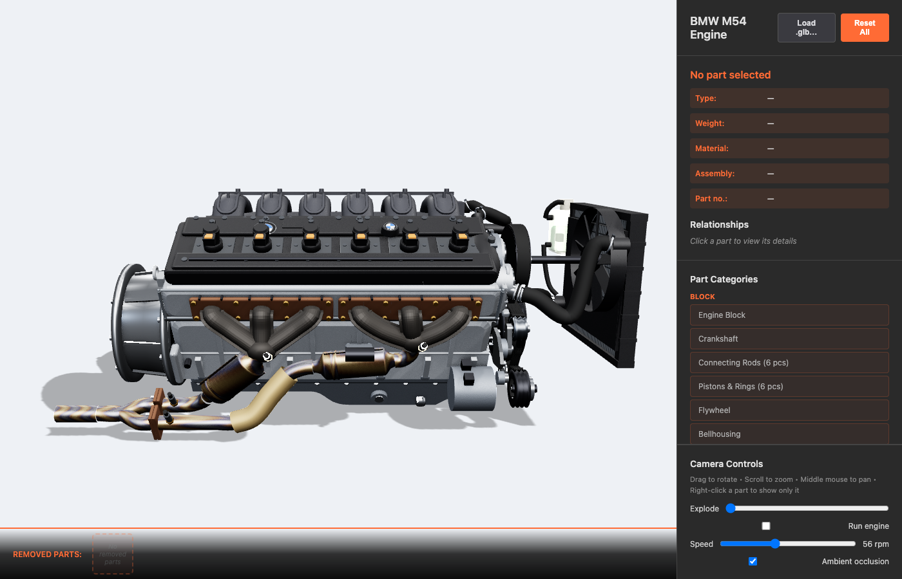
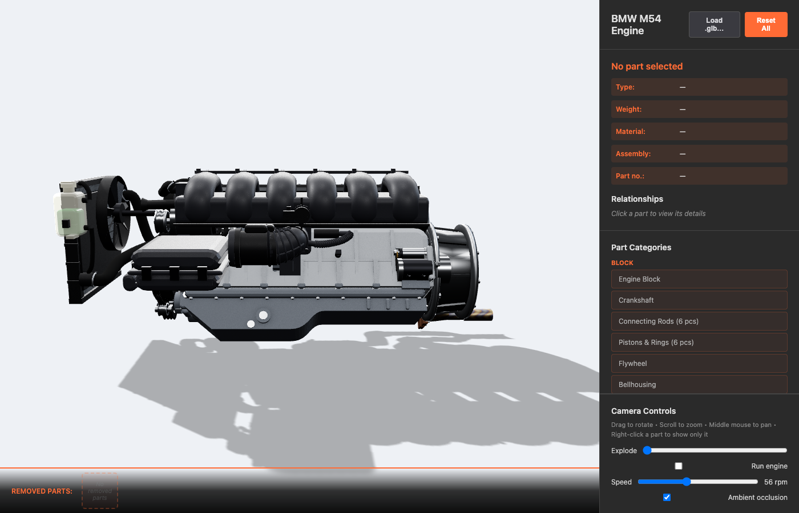

# BMW M54 Engine 3D Interactive Model

An interactive 3D visualization of a BMW M54 inline-6 engine that lets you progressively
disassemble the engine by removing individual parts one by one. Ships with a built-in
procedural M54, and can load any real `.glb` engine model at runtime.




*Screenshots: `npm run shot -- exhaust` / `intake` (software-rendered, so lighting is flatter than on a real GPU).*

## Features

✅ **Built-in procedural M54** - 30+ parts (block, head, crankshaft, intake/exhaust, cooling, oil, ignition, accessories) with rounded cast-metal geometry, studio lighting, image-based reflections, and contact shadows

✅ **Load any real `.glb` model** - Click **Load .glb…** to hot-swap in a real high-poly engine model. It's auto-split into individually removable meshes, and the parts list rebuilds from the model's mesh nodes

✅ **Interactive Part Removal** - Remove parts (rotate + slide + fade animation); removed parts appear as chips at the bottom and can be restored by clicking them

✅ **Part Information Panel** - Name, type, weight, material, assembly, and relationships

✅ **Reset Functionality** - One-click restore of the full assembly

✅ **Interactive Camera** - Orbit, zoom, and pan with the mouse

## Loading your own engine model

1. Launch the app and click **Load .glb…** (top-right), then pick any `.glb`/`.gltf` file. It swaps in live.
2. To auto-load a model on startup instead, set `window.ENGINE_GLB` in [`src/boot.js`](src/boot.js) to your model's path (e.g. `'./models/your-m54.glb'`). Leave it `null` to boot the procedural M54.

> **Note on the bundled example:** `models/2CylinderEngine.glb` is the Khronos *2CylinderEngine*
> sample, included only to demonstrate the loader. Its license is **not confirmed CC0**, and it's a
> 2-cylinder, not an M54 — replace it with a model whose license you've verified before shipping.

## Rendering pipeline

- **Three.js r160** (vendored under `vendor/`), loaded as ES modules via an import map
- **GLTFLoader** for real models, **RoomEnvironment + PMREM** for image-based reflections
- **ACES filmic tonemapping**, soft (PCF) shadows, light studio background

## Requirements

- Node.js 16+
- npm or yarn

## Installation

```bash
npm install
```

## Running the Application

```bash
npm start
```

This will launch the Electron application with the BMW M54 engine 3D model.

### In a plain browser

```bash
npm run serve   # http://localhost:8080 (optional: npm run serve -- 3000)
```

No build step: `index.html` loads everything from the repo (Three.js and its addons are vendored under `vendor/`, all paths are relative). `src/main.js` is the only Electron-specific file and the page never touches it.

### Deploy to GitHub Pages

Push the repo, then Settings → Pages → Source: *Deploy from a branch*, branch `main`, folder `/ (root)`. The site is served at `https://<user>.github.io/<repo>/`. `node_modules/` is not needed. Large `models/*.glb` files count toward Pages' 1 GB limit.

## Project Structure

```
bmw-m54-engine/
├── src/
│   ├── main.js            # Electron main process
│   ├── boot.js            # Loads Three.js + GLTFLoader as globals
│   ├── app.js             # Scene, interaction, animation, UI, app init
│   └── parts/             # Procedural M54 geometry, one file per part
│       ├── index.js       # Build order + shared context
│       ├── materials.js   # Shared materials
│       ├── helpers.js     # reg/detail, roundedBox, pulleys, belts
│       ├── layout.js      # Shared dimensions (LEN, BW, headY, cx(i)…)
│       └── vanos.js, oil-pan.js, intake.js, …
├── refs/                  # Reference photos + notes.md, one folder per part
├── data/parts-database.json
├── styles/main.css
├── index.html
└── CLAUDE.md              # Working rules for Claude Code sessions
```

## Controls

- **Left Click**: Select a part (shows info and highlights it)
- **Drag Mouse**: Rotate camera around engine
- **Scroll Wheel**: Zoom in/out
- **Middle Mouse**: Pan camera
- **Reset All Button**: Restore full engine assembly

## Engine Parts Included

### Main Assembly (Block)
- Engine block with 6 cylinders
- Crankshaft with counterweights
- Connecting rods & pistons
- Flywheel

### Cylinder Head Assembly
- Cylinder head
- Camshafts (intake & exhaust)
- Timing chain & tensioners
- VANOS actuators

### Systems
- **Intake**: Manifold, throttle body, fuel injectors
- **Exhaust**: Manifold, oxygen sensors
- **Cooling**: Water pump, thermostat, radiator, coolant tank
- **Oil**: Oil pan, pump, filter housing
- **Ignition**: Spark plugs, ignition coils
- **Accessories**: Alternator, AC compressor, power steering pump, serpentine belts

## Technical Stack

- **Electron**: Desktop application framework
- **Three.js**: WebGL 3D rendering
- **Tween.js**: Smooth animation framework
- **Node.js**: JavaScript runtime

## Features Implemented

### Phase 1: Foundation ✅
- Electron app scaffold with Three.js scene
- Engine block + cylinder head geometry
- Basic camera controls
- Part database schema

### Phase 2: Parts & Interaction ✅
- All 30+ parts with realistic geometry
- Raycasting click detection
- Part highlighting on hover
- Part name display

### Phase 3: Animation & Removal ✅
- Smooth removal animation (rotate + slide + fade)
- Parts tracking system
- Animation state management

### Phase 4: Information & UI ✅
- Technical specs display
- Assembly relationships
- Parts list by category
- Reset all functionality

### Phase 5: Polish & Optimization (In Progress)
- Performance optimization
- Additional visual effects
- Cross-section/cutaway view (planned)

## Educational Use

This model is designed for:
- Understanding BMW M54 engine architecture
- Learning component relationships
- Studying engine assembly structure
- Reference for engine mechanics and specifications

## License

Educational use - MIT License

## Author

Created with Claude Code
